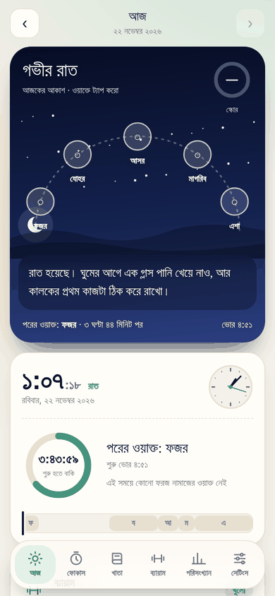
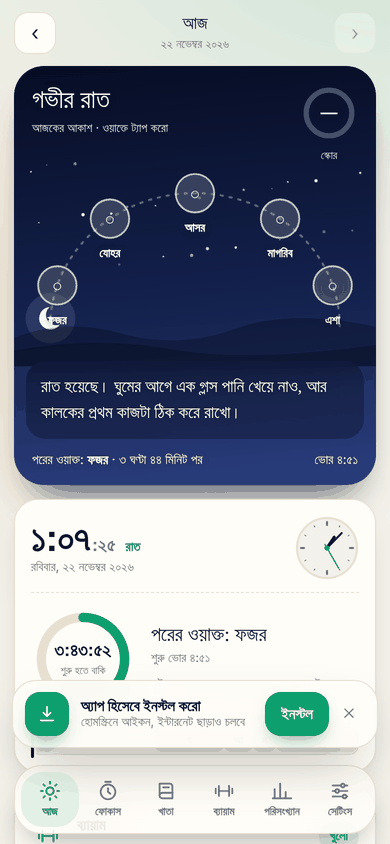
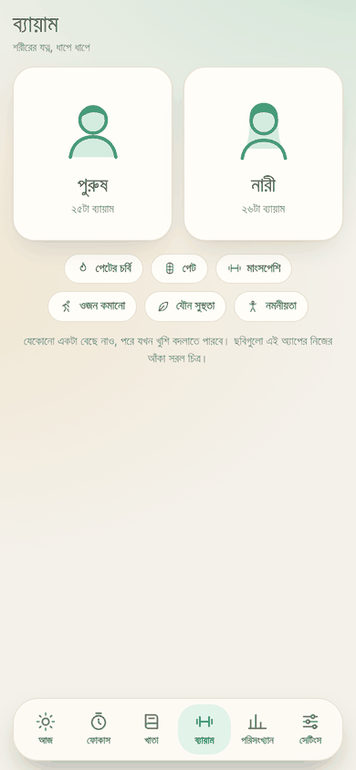

<div align="center">


# Aalo

**A calm daily companion, in Bangla and English.**

Track prayers, water, sleep, study, exercise and your own thoughts in one place.
Works fully offline. Your data never leaves your phone.

[](#install)
[](#how-it-works)
[](#privacy)
[](#how-it-works)

**[Open the app](https://USERNAME.github.io/aalo/)**

  

</div>

## What is Aalo?

Aalo ("light" in Bangla) is a small web app, in Bangla or English (switch any time in More → Language), that helps you look at your day honestly: what you did, what slipped, and where to start tomorrow. Install it from the browser and it behaves like a native app. No account, no server, no ads.

## Features

| | |
|---|---|
| **Worship** | Five daily prayers with a sky that follows the prayer times, Quran reading log, tasbih counter |
| **Daily tracking** | Water, sleep, study, work and wasted time, with a daily score |
| **Focus** | Focus timer with distraction guard, daily goals, habits |
| **Deen** | Topic-based Quran verses with meanings (hardship, joy, motivation, daily life, the Prophet's ﷺ guidance), hadith, morning-to-night duas and dhikr with Bangla pronunciation, all namaz duas, and special surahs (Fatiha, Baqarah, Kahf, full Mulk, Qadr and all the short surahs used in prayer) with Arabic, pronunciation, meaning and virtues |
| **Tools** | Qibla compass, zakat calculator, BMI and calorie calculator, Hijri date |
| **Deen extras** | Search across all duas, verses and hadith (Bangla or English) and a saved-favorites list |
| **Privacy** | Optional PIN lock for the notebook (casual-privacy only, not encryption) |
| **Reminders** | Add medicine names and times; Aalo alerts you at the exact time with Taken / Snooze / Skip, and can export them to your phone calendar (.ics) for a reliable system alarm |
| **Language** | Full Bangla and English interface |
| **Journal** | Private notes and thoughts, stored only on your device |
| **Fitness guide** | Empty vs full stomach rules, lower-back pain, neck and hunched back, spine care, fitness tips, six-pack, fat loss and preventing weight gain |
| **Exercise guide** | Separate Male / Female programmes, grouped by goal (belly fat, muscle, weight loss, wellbeing). Each exercise has a drawn how-to figure, benefits, when to do it, common mistakes, and a set/rep target you can save |
| **Stats** | Weekly and monthly charts, streaks, achievements |
| **Backup** | Export and import everything as a single JSON file |

## Install

| Device | How |
|---|---|
| Android (Chrome) | Open the link, tap **Install** in the banner |
| iPhone / iPad | Safari → Share → **Add to Home Screen** |
| Desktop (Chrome / Edge) | Click the install icon in the address bar |

Aalo also shows an in-app **update** banner when a new version is available, and Settings → *App & updates* lets you check manually.

## Privacy

There is no backend. Everything is stored in your browser's `localStorage`, so clearing browser data or switching phones will erase it. Use **Settings → Backup** regularly.

On iPhone, the Safari tab and the installed app keep separate storage. Back up before installing.

## Deploy to GitHub Pages

1. Create a public repository named `aalo`.
2. Upload every file in this folder to the repository root, including the hidden `.nojekyll`.
3. Go to **Settings → Pages**, choose **Deploy from a branch**, select `main` and `/ (root)`, then save.
4. After a minute or two the app is live at `https://USERNAME.github.io/aalo/`.

### Releasing an update

1. Edit `index.html`.
2. Bump `VER` at the top of `sw.js` (for example `'4.2'` → `'4.3'`). Without this, installed apps won't detect the change.
3. Commit. Users see the update banner next time they open the app.

## How it works

- A single-file app in plain HTML, CSS and JavaScript, with no framework or build step
- Service worker with network-first caching, so it is always fresh online and fully usable offline
- Web app manifest with maskable icons and home-screen shortcuts
- Exercise figures are drawn by a small built-in SVG stick-figure engine
- Light and dark themes, safe-area aware, responsive from phones to desktop

```
.
├── index.html                 the whole app
├── sw.js                      offline cache and update flow
├── manifest.webmanifest       install metadata and shortcuts
├── icon-*.png, apple-touch-icon.png, favicon-48.png
├── 404.html
├── .nojekyll
└── shots/                     screenshots
```

## Good to know

- Prayer times are calculated approximately (Karachi method, Hanafi Asr). Always check against your local mosque.
- Exercise figures are simple illustrations, not a replacement for a trainer. If you have an injury or health condition, ask a doctor first.
- Fat cannot be burned from one body part alone; the belly programme works best alongside overall weight loss.
- Background notifications depend on the browser and are unreliable on iPhone. For medicine reminders, also use **Reminders → Add to phone calendar** so the phone itself rings.
- Quran verses, hadith and duas were typed carefully but please verify against a printed mushaf or a trusted scholar before relying on them. Reports of mistakes are welcome.
- The English interface is translated automatically phrase by phrase; some lines may read awkwardly. Please open an issue.
- The Qibla compass depends on your phone's sensor and is not available on every device. Zakat and BMI results are estimates; confirm zakat rulings with a scholar.
- Reminders are only a memory aid. Follow your doctor's instructions for medicine.

---

<div align="center">

Made by **Md. Foisal Hossen Chowdhury** · CSE, IIUC

</div>
